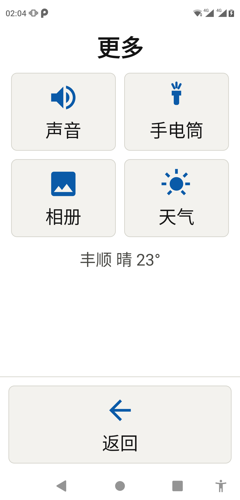
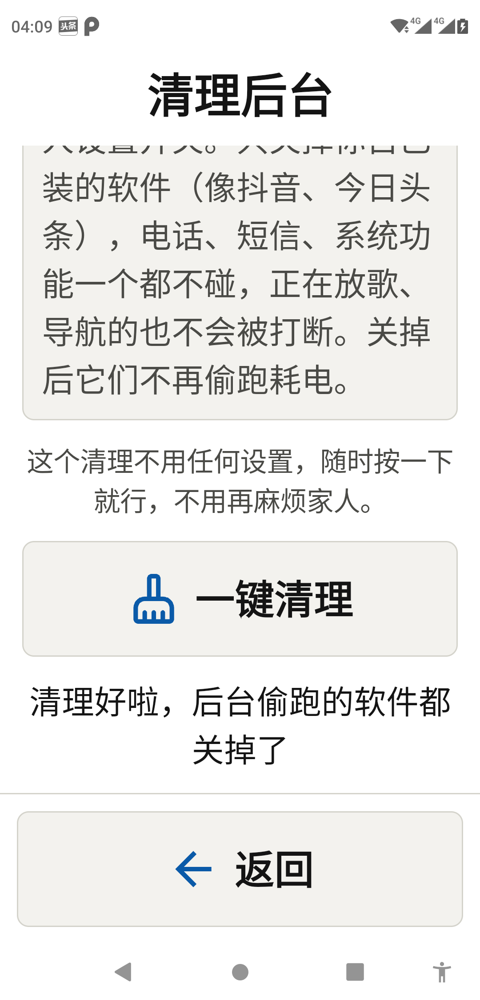
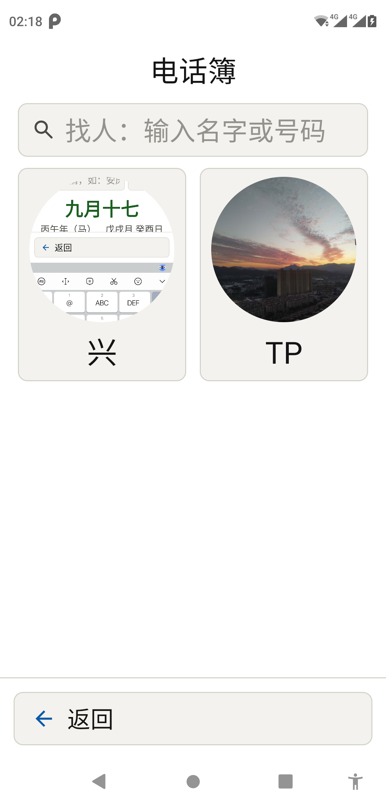

# 长辈手机适老化改造 · elder-phone-makeover

> 把一个只会简单用 AI 的小白，通过**对话**带完整个改造闭环：把家里老人的安卓手机，
> 变成一个字大、好按、看得懂的「长辈桌面」。技术活由脚本干，小白只需在手机上做
> 「插线 / 点允许 / 按主页键 / 解锁」这类动作。

**这不是一个要你懂 adb、会编译源码的项目，而是一个 [WorkBuddy](https://www.workbuddy.cn) 技能（Skill）。**
你只要对支持技能的 AI 说一句「帮我给老人手机做适老化改造」，剩下的连机检测、安装、
设默认桌面、按家配置、验收、教老人、回退，AI 会一步步带你做完。

| 主屏 | 更多功能 |
|---|---|
|  |  |
| **一键清理**（无需任何设置） | **电话簿**（大头像 + 搜索，人数不限） |
|  |  |

---

## 这个项目解决什么

老人用不惯智能机，通常卡在这几件事上：**字太小看不清、图标太多找不到、软件后台偷跑
又卡又耗电、话费流量不知道剩多少、一不小心点错**。子女想帮忙，但自己也不是技术高手，
一看到「USB 调试」「默认桌面」「无障碍」就头大。

这个技能把「适老化改造」这件事本身做成了产品：

- **给谁用**：想给爸妈/长辈弄手机、但只会简单用 AI 的普通子女（不是开发者）。
- **做成什么**：一部普通安卓手机 → 大字时钟 + 农历、天气电量、几个常用 App 大图标、
  打电话/电话簿/更多三大按钮，一按主页键就回到它。
- **凭什么省心**：连机、安装、读设备信息、验收都由脚本自动完成；AI 全程说生活语言、
  一次只让你做一个动作；安装和配置**不会删**老人的照片、微信、通讯录、聊天记录，
  随时能换回原桌面。

## 能做什么

- **主屏**：大字时钟、农历、老黄历；天气与电量同行；常用 App 大图标（最多 6 个）；
  打电话 / 电话簿 / 更多 三大按钮。
- **天气**：数据源中国天气网，实时温度 + 24 小时 + 一周预报，大返回按钮。
- **电量**：百分比常驻 + 充电状态；电池分满电/高/低/需充电四档，充电中有动态图标。
- **一键清理**：结束第三方 App 的后台进程（抖音、今日头条这类），**零开关、不依赖
  无障碍、不掉线**；电话、短信、系统功能、桌面自身、正在放歌导航的前台服务一律不动。
- **话费流量**：账单短信 + 本机流量账本融合，显示话费余额与套餐剩余流量，兼容三网，
  运营商侧不给数字时如实说明。
- **电话簿**：人数不限、姓名/号码实时搜索、从系统相册选大头像、私有目录持久化不丢。
- **更多**：手电筒、声音、相册、老黄历等。
- **回退**：永不禁用原厂桌面，随时能在系统设置里改回或直接卸载。

## 怎么用（两种方式）

### 方式 A：让 AI 带你做（推荐，小白用这个）

在支持技能的 AI 工具（如 WorkBuddy）里安装本技能后，直接说：

> 帮我给我妈的手机做适老化改造 / 给老人装个大字桌面 / 教老人用这个手机

技能会自动触发，按七阶段引导你。**你不需要看懂下面任何命令。**

### 方式 B：只想要成品 APK，自己装

`assets/elder-launcher.apk` 是已验证的成品桌面（`com.elderhome.launcher.debug`，
debug 签名，仅供体验）。用数据线连上手机、开启 USB 调试后：

```sh
adb install -r assets/elder-launcher.apk
# 然后在手机上按主页键，选择「长辈桌面」并点「始终」
```

> 完全不用 AI、不用编译。但「按家配置」（天气城市、常用 App、联系人头像）需要
> **长按主屏大时钟约 3 秒**进隐藏设置手动做，见 `assets/给家人的一页纸.md`。

### 进阶：脚本（供 AI 或懂命令行的人）

```sh
python scripts/elder_tool.py --json check                # 连机体检（只读）
python scripts/elder_tool.py --json info                 # 设备/系统/是否已装/默认桌面（只读）
python scripts/elder_tool.py --json install              # 安装（默认用自带成品 APK）
python scripts/elder_tool.py --json home                 # 默认桌面状态 + 设置引导
python scripts/elder_tool.py --json verify               # 验收（只读，能识别锁屏/息屏）
python scripts/elder_tool.py --json rollback --confirm   # 卸载回退（危险，须先确认）
python scripts/build_apk.py --json                      # 可选：有源码+工具链时离线重编译
```

脚本自动探测 adb；找不到时用 `--adb "你的adb路径"` 或环境变量 `ELDER_ADB` 指定。
详见 [references/02_连机与环境.md](references/02_连机与环境.md)。

## 目录结构

```
elder-phone-makeover/
├── SKILL.md                    # 技能主文件（触发条件、铁律、工作流）——给 AI 读
├── README.md                   # 本文件——给人读
├── LICENSE / NOTICE.md         # MIT 许可 + 第三方资源署名
├── CHANGELOG.md                # 版本记录
├── scripts/
│   ├── elder_tool.py           # 核心自动化（7 个子命令）
│   └── build_apk.py            # 可选离线重编译（一般不需要）
├── references/                 # 按需读取的专题文档（6 篇）
│   ├── 01_改造流程.md          # 主剧本：七阶段决策门与话术
│   ├── 02_连机与环境.md        # USB 调试、数据线、掉线排查、隐私边界
│   ├── 03_按家配置.md          # 天气城市、常用 App、联系人头像、字号
│   ├── 04_兼容与限制.md        # 系统门槛、能力边界、运营商现状
│   ├── 05_故障排查.md          # 真机踩坑提炼
│   └── 06_教老人与交接.md      # 念给老人的话术、回退
└── assets/
    ├── elder-launcher.apk      # 已验证成品桌面 APK
    ├── preview/                # 真机预览图（4 张）
    └── 给家人的一页纸.md        # 可打印、贴手机旁的留底说明
```

## 当前验证状态，而非通用保证

**诚实说明**：本项目只在下面这台真机上完整验证过。换机型请按实际复核，
未验证项不作为保证——这是设计原则，不是免责套话。

| 环境 | 状态 | 换设备需复核 |
|---|---|---|
| Nokia X7 / Android 9（SDK 28） | ✅ 完整验证：安装、默认桌面、天气电量、一键清理 7→0、电话簿、回退 | — |
| 其他安卓 8–13 手机 | 预计可用，未逐台实测 | USB 调试/默认桌面选择器位置、安卓 11+ 包可见性 |
| 安卓 14（API 34）及以上 | ⚠️ 一键清理受系统限制，会如实提示、不做有害动作 | 系统是否允许第三方结束他人进程 |
| 移动/电信话费短信查询 | 代码已实现，本机无对应 SIM 未实测 | 指令、厂商短信二次确认弹窗 |
| 中国联通话费短信 | ⚠️ 2026-10 起短信营业厅不再返回数字，只引导其 App | 只能装运营商 App 或接受如实提示 |

已知能力边界、权限清单、运营商现状见 [references/04_兼容与限制.md](references/04_兼容与限制.md)。

## 边界与隐私（先说清楚）

- **不需要 root**，全程普通 adb 调试。
- **不依赖无障碍**：一键清理用普通权限实现，安装即授予、不会掉线，家人一次都不用设置。
- **不删数据**：安装/配置/卸载都不动老人手机里的照片、通讯录、聊天记录和其他软件。
- **不接管不可回退**：永不禁用原厂桌面，随时能在系统设置改回或直接卸载。
- **隐私**：除天气外无联网行为，不上传数据、无统计遥测；不申请定位、不读系统通讯录、不录音。
- 真机测试若模拟过电量/注入过数据，**测完会完整还原**（`dumpsys battery reset` 等）。

## 反馈与获取

- 发现机型兼容问题或 bug，欢迎提 [Issue](../../issues)，按模板填写（**请勿贴序列号、
  手机号、局域网地址或任何密钥**）。
- 需要这套技能、或想要针对自家老人定制（换默认城市、预置联系人、改配色字号），
  **在推广内容评论区留言即可获取**。

## 许可与来源

- 代码与文档：**MIT**，见 [LICENSE](LICENSE)。
- 界面图标：Google Material Symbols（Apache 2.0）；天气数据：中国天气网。
  完整署名见 [NOTICE.md](NOTICE.md)。
- 成品源自自建项目「项目-0041 安卓适老化桌面」，非第三方开源项目。
